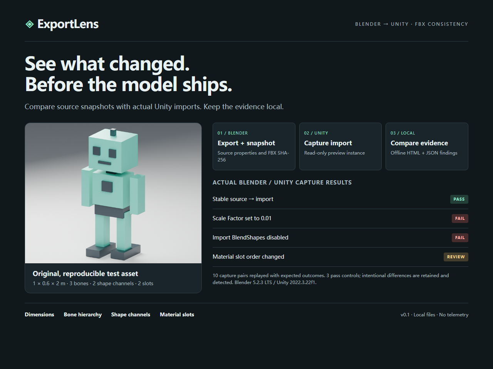
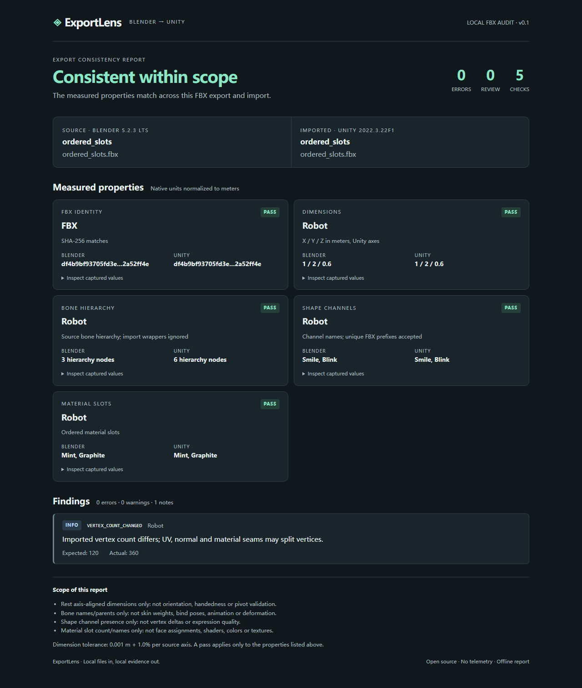
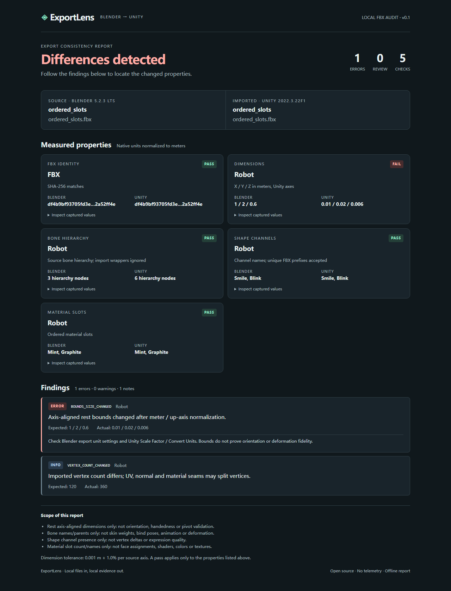

# ExportLens

**Find what changed between a Blender FBX export and its Unity import.**

[简体中文](README.zh-CN.md) · [Snapshot format](docs/schema.md) · [Design and limits](docs/design.md) · [Validation record](docs/testing.md)

[Download v0.1.0](https://github.com/TMAK1710/exportlens/releases/tag/v0.1.0) · [GitHub Actions](https://github.com/TMAK1710/exportlens/actions/workflows/ci.yml)

ExportLens captures a source snapshot in Blender, captures the imported FBX in Unity, and compares them locally. The HTML report points to changed physical dimensions, missing bones or parent links, missing shape channels, and changed material slots. The JSON report can be used in build checks.

It is a small, inspectable audit tool for an existing FBX workflow. A passing report covers the checks below; it does not certify the complete appearance or behavior of a model.



## What it checks

| Check | Behavior |
| --- | --- |
| Exported artifact | Compares SHA-256 of the exact FBX used for each capture. Missing hashes require review; different hashes fail. |
| Physical dimensions | Compares rest/base axis-aligned bounds in meters after Blender Z-up → Unity Y-up normalization. Default tolerance: 1 mm + 1% per axis. |
| Bones | Checks source bone names and parents, allowing extra import wrapper nodes between known bones. |
| Shape keys / BlendShapes | Checks channel names; a unique importer prefix such as `Mesh.Smile` can match `Smile`. |
| Material slots | Checks slot count and ordered names. Name changes require review. |
| Vertex count | Records differences as information: UV, hard-normal and material seams can split imported vertices. |

Animation, skin weights, bind poses, deformation, shape deltas, pivot/orientation/handedness, polygon-to-material assignments, shaders, colors and textures are outside v0.1. See [the full limits](docs/design.md).

## Try the included captures

The examples contain snapshots from actual Blender **5.2.3 LTS** → FBX → Unity **2022.3.22f1** runs using an original synthetic robot. Replaying them needs only Python; it does not launch an editor:

```powershell
python -m exportlens compare examples/fixtures/ordered_slots.source.json examples/captures/ordered_slots.unity.json --output reports/demo
```

Open `reports/demo/report.html`. To replay all ten recorded cases, including deliberately failing cases, and assert their exact expected finding sets:

```powershell
python tools/verify_integration.py --fixtures examples/fixtures --captures examples/captures --output reports/verification
```

The verification command returns success when the three pass, three review and four fail cases match their expected outcomes. It does not re-export FBX or rerun Unity. [The validation record](docs/testing.md) explains how each case was produced.

## Distribution files

Four artifacts are prepared for distribution alongside the repository:

| Artifact | Use |
| --- | --- |
| `ExportLens-0.1.0-source.zip` | Full source, documented examples, reports and screenshots. Extract it to follow the commands above. |
| `ExportLens-Blender-0.1.0.zip` | Install directly through Blender's add-on preferences; no manual ZIP creation is needed. |
| `com.exportlens.editor-0.1.0.tgz` | Package Manager → **+ → Add package from tarball**. Source installation from `unity/package.json` also works. |
| `exportlens-0.1.0.pyz` | Portable comparator; run `python exportlens-0.1.0.pyz compare source.json target.json --output reports/my-asset` with Python 3.10+. |

Use `SHA256SUMS.txt` to verify the downloaded files. The `.pyz` provides the comparator; use the source archive for the included capture examples. Blender and Unity are installed separately when collecting your own assets.

## Quick start

You need Python 3.10 or later, Blender 4.2 or later with its FBX exporter, and a Unity 2022.3 or later Editor project. These are declared minimums; exact tested versions and results are recorded in [Validation](docs/testing.md). The Python comparator uses only the standard library: no account, API key, model download or Python runtime dependency is needed.

### 1. Capture and export from Blender

1. Download or clone this repository.
2. Zip the `blender_addon` directory, preserving `blender_addon/__init__.py` inside the archive. Install that ZIP through Blender's add-on preferences and enable **ExportLens — FBX Consistency Snapshot**. In Blender versions with an extensions menu, use **Install from Disk**.
3. Select the mesh or asset root to inspect. Children and armatures needed by selected meshes are included.
4. Open the 3D View sidebar (`N`) → **ExportLens** → **Export FBX + Snapshot**. Choosing `my-asset.fbx` also writes `my-asset.source.json` beside it. Use this paired JSON as `source.json` in the commands below, or substitute its actual filename.

**Save Source Snapshot** is also available for inspection without exporting. That JSON has no FBX hash, so a comparison using it requires review.

The audited export uses base geometry, preserves shape channels, disables animation baking and leaf bones, and records the FBX hash. It does not apply modifiers or edit your model. Finish geometry modifiers yourself on a copy when the intended deliverable needs them; otherwise this base-geometry audit does not describe the evaluated result.

### 2. Capture the FBX in Unity

1. In **Window → Package Manager**, choose **+ → Add package from disk** and select `unity/package.json` in this checkout.
2. Import the FBX from step 1 into your project's `Assets` directory using the settings you want to audit.
3. Select that `.fbx` asset in the Project window.
4. Open **Tools → ExportLens → Snapshot FBX**, then **Capture snapshot JSON**. Save the target snapshot, for example as `target.json`.

One capture covers one FBX, which may contain several meshes. The collector reads a temporary preview instance and does not change the FBX's importer settings. Capture the imported asset, rather than an edited scene instance.

### 3. Compare

From the repository root:

```powershell
python -m exportlens compare source.json target.json --output reports/my-asset
```

Open `reports/my-asset/report.html` in a browser and keep `report.json` for a machine-readable record. Both are local files.

| Exit code | Meaning |
| --- | --- |
| `0` | All implemented checks pass; informational differences may be present. |
| `1` | Differences or review findings need attention. |
| `2` | Invalid input, invalid configuration, or a command/input error. |

Reports have three states: **pass**, **review** (warnings without errors), and **fail** (one or more errors). A deliberately renamed material can require review without indicating a broken model. Missing shape channels and changed dimensions are errors.

### Intentional names and tolerance

Use a configuration file when a source mesh was deliberately renamed or a pipeline needs a different physical tolerance:

```json
{
  "mesh_map": {"Body": "Body_Imported"},
  "absolute_tolerance_m": 0.001,
  "relative_tolerance": 0.01
}
```

```powershell
python -m exportlens compare source.json target.json --output reports/my-asset --config config.json
```

Mappings must be one-to-one. Duplicate mesh names are rejected instead of being paired by position or guessed. Native unit values are not expected to match: Blender scene units and Unity's importer conversion can differ while the physical dimensions agree.

## Reading the result





Start with FBX identity, then dimensions and missing data. A hash mismatch often means an old JSON file was paired with a newer FBX. A dimension error suggests checking export units and Unity's Scale Factor / Convert Units. A missing blend shape suggests checking FBX modifier export and Unity's Import BlendShapes setting.

The screenshots use this repository's synthetic fixture; they do not expose a purchased avatar or a user's production project. [The validation record](docs/testing.md) distinguishes actual Blender/Unity integration evidence from comparator-only cases.

## Local processing and sharing

The collectors and comparator operate locally and do not send the model or reports to a service. Snapshot `source_file` stores a basename, not an absolute file path. Object names, bone names, material names and hierarchy paths can still reveal project structure. Review snapshots, reports and screenshots before making them public. Blender and Unity themselves may have their own services and settings.

## Development

```powershell
python -m unittest discover -s tests -v
```

See [CONTRIBUTING](CONTRIBUTING.md) for fixture rules and [Validation](docs/testing.md) for the integration procedure. The source code and self-created synthetic fixture are provided under the [MIT license](LICENSE).

Existing tools informed the scope. MeshSync provides live DCC synchronization, while BlenderToUnity addresses export axis preparation. ExportLens focuses on before/after evidence from an FBX import; it does not replace those tools. See [the reuse research](docs/research.md) for primary links and the decision.
