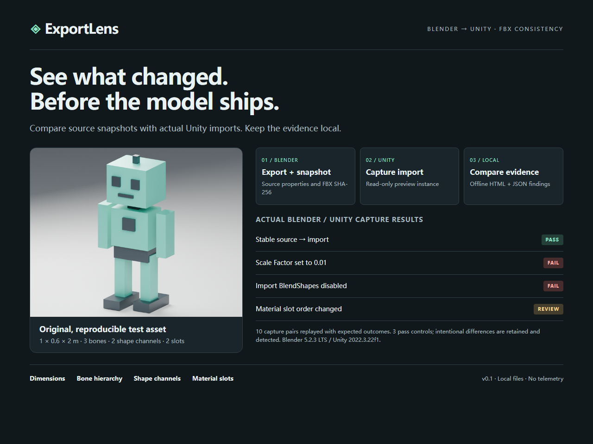
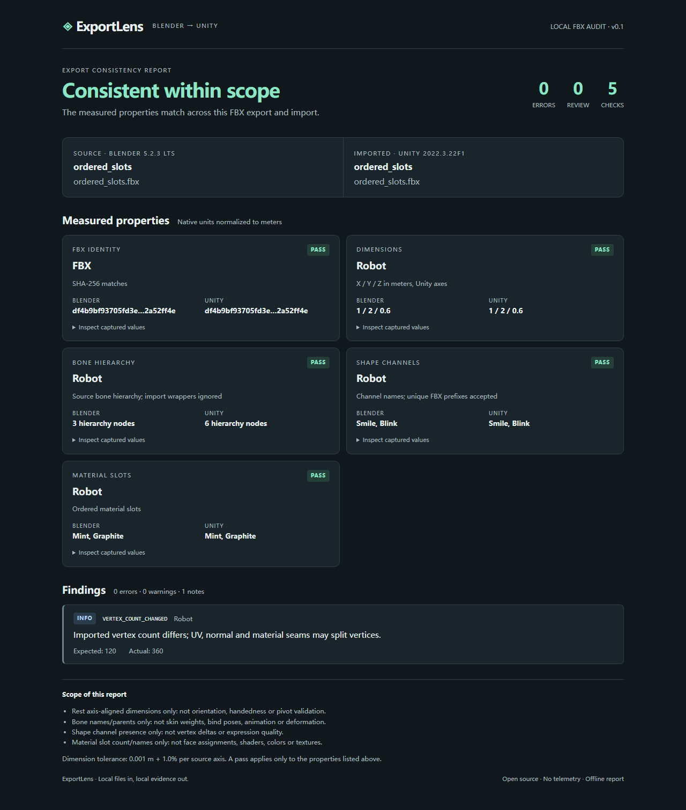
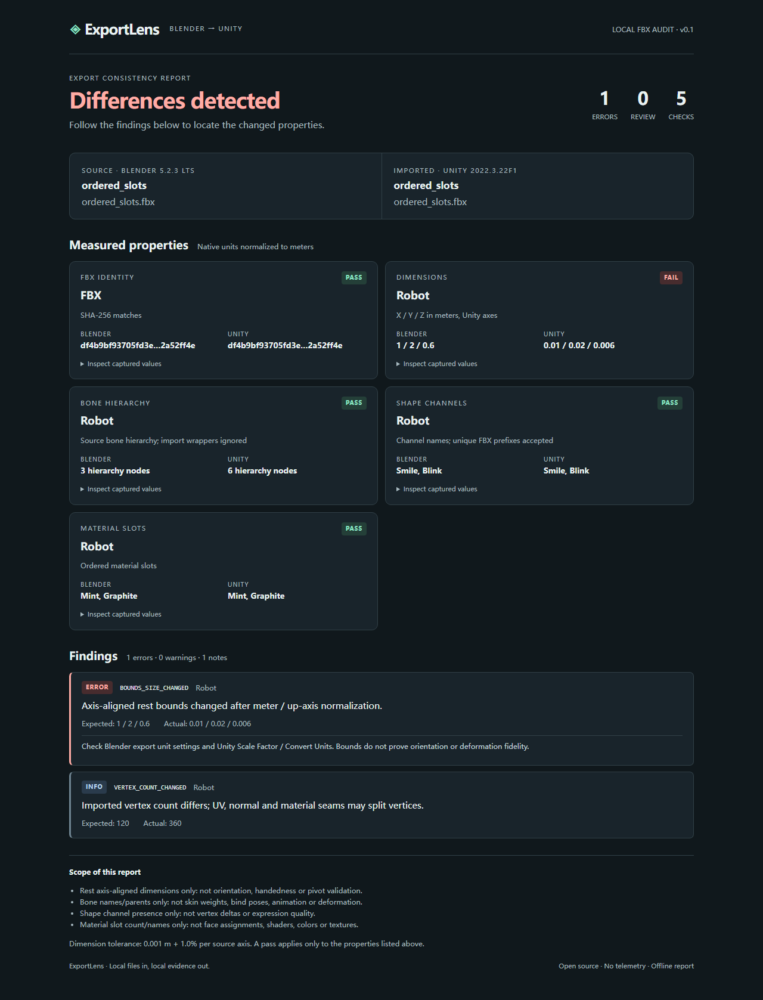

# ExportLens

**检查 Blender 导出的 FBX，导入 Unity 后到底改变了什么。**

[English](README.md) · [快照格式](docs/schema.md) · [设计与局限](docs/design.md) · [测试记录](docs/testing.md)

[下载 v0.1.0 安装包](https://github.com/TMAK1710/exportlens/releases/tag/v0.1.0) · [GitHub 自动检查](https://github.com/TMAK1710/exportlens/actions/workflows/ci.yml)

ExportLens 分别在 Blender 和 Unity 中记录快照，再在本地比较。HTML 报告会指出物理尺寸变化、骨骼或父子关系丢失、Shape Key／BlendShape 通道缺失，以及材质槽变化；JSON 报告可供构建检查使用。

它面向现有的 FBX 工作流，检查范围明确。报告通过，只代表已实现的检查通过，不代表模型外观和运行表现已经全部验证。



## 检查内容

| 项目 | 检查方式 |
| --- | --- |
| FBX 身份 | 对比两份快照对应的 FBX SHA-256。缺少哈希需复核；哈希不同则失败。 |
| 物理尺寸 | Blender Z 向上 → Unity Y 向上后，按米比较基础／静止网格的轴对齐包围盒。每轴默认容差为 1 毫米 + 1%。 |
| 骨骼 | 检查源骨骼名称和父骨骼，允许导入器在已知骨骼间增加包装节点。 |
| Shape Key／BlendShape | 检查通道名称；可识别 `Mesh.Smile` 对应 `Smile` 这样的唯一前缀。 |
| 材质槽 | 检查槽数和有序名称。名称变化提示复核。 |
| 顶点数量 | 只记录信息。UV、硬法线和材质边界可能让 Unity 拆分顶点，数量变化不直接判定为错误。 |

v0.1 不检查动画、蒙皮权重、绑定姿势、实际形变、形态键顶点偏移、轴向／镜像／枢轴、面到材质槽的分配、着色器、颜色和纹理。[完整局限](docs/design.md)有具体说明。

## 先试仓库自带样例

样例来自自建机器人在 Blender **5.2.3 LTS** → FBX → Unity **2022.3.22f1** 的真实采集结果。重放只需要 Python，不会启动编辑器：

```powershell
python -m exportlens compare examples/fixtures/ordered_slots.source.json examples/captures/ordered_slots.unity.json --output reports/demo
```

打开 `reports/demo/report.html`。也可重放全部十例，并检查状态及具体差异代码是否符合预期：

```powershell
python tools/verify_integration.py --fixtures examples/fixtures --captures examples/captures --output reports/verification
```

三例通过、三例需复核、四例故意失败均符合预期时，验证命令返回成功。该命令重放已有快照，不重新导出 FBX 或运行 Unity。各例如何生成见[测试记录](docs/testing.md)。

## 分发文件

仓库配套准备四类分发文件：

| 文件 | 用法 |
| --- | --- |
| `ExportLens-0.1.0-source.zip` | 包含源码、样例、报告和截图。解压后可执行上面的命令。 |
| `ExportLens-Blender-0.1.0.zip` | 直接在 Blender 插件设置中安装，无须手动压缩文件夹。 |
| `com.exportlens.editor-0.1.0.tgz` | Package Manager → **+ → Add package from tarball**；也可从源码的 `unity/package.json` 安装。 |
| `exportlens-0.1.0.pyz` | 便携比较器。使用 Python 3.10+ 执行 `python exportlens-0.1.0.pyz compare source.json target.json --output reports/my-asset`。 |

可用 `SHA256SUMS.txt` 校验下载文件。`.pyz` 提供比较器，自带快照样例在源码包中；采集自己的资产时需单独安装 Blender 和 Unity。

## 快速使用

需要 Python 3.10 或更高版本、带 FBX 导出器的 Blender 4.2 或更高版本，以及 Unity 2022.3 或更高版本的 Editor 项目。这些是声明的最低版本；实际测试版本及结果见[测试记录](docs/testing.md)。Python 比较器只用标准库，无须账号、API Key、模型下载或额外 Python 运行时依赖。

### 1. Blender 中导出并记录源快照

1. 下载或克隆本仓库。
2. 将 `blender_addon` 文件夹压缩成 ZIP，确保压缩包内保留 `blender_addon/__init__.py`。在 Blender 插件设置中安装 ZIP，并启用 **ExportLens — FBX Consistency Snapshot**。带扩展菜单的版本使用 **Install from Disk／从磁盘安装**。
3. 选择要检查的网格或资产根物体。工具会包含子物体以及网格需要的骨架。
4. 打开 3D 视图侧栏（`N`）→ **ExportLens** → **Export FBX + Snapshot**。选择 `my-asset.fbx` 时会在旁边生成 `my-asset.source.json`。后面的命令中用这份配套 JSON 代替 `source.json`，或自行替换实际文件名。

也可用 **Save Source Snapshot** 只保存 JSON，不导出模型。它没有 FBX 哈希，使用这种快照比较时会提示复核。

该导出使用基础网格，保留形态通道，不烘焙动画、不生成末端骨骼，并记录 FBX 哈希。工具不会应用修改器或修改模型。如果交付物需要修改器效果，请在副本中先完成几何处理；基础网格检查不能代表修改器计算后的模型。

### 2. Unity 中记录导入结果

1. 打开 **Window → Package Manager**，点击 **+ → Add package from disk**，选择本仓库的 `unity/package.json`。
2. 把步骤 1 的 FBX 放入项目 `Assets`，按你准备检查的设置导入。
3. 在 Project 窗口中选择该 `.fbx` 资产。
4. 打开 **Tools → ExportLens → Snapshot FBX**，点击 **Capture snapshot JSON**，例如保存为 `target.json`。

每次记录一个 FBX，支持文件内多个网格。采集器读取临时预览实例，不修改模型导入设置。请选择导入资产，不要用手动修改过的场景实例代替。

### 3. 生成报告

在仓库根目录执行：

```powershell
python -m exportlens compare source.json target.json --output reports/my-asset
```

浏览器打开 `reports/my-asset/report.html`；`report.json` 可用于保留记录或自动检查。文件都保存在本地。

| 退出码 | 含义 |
| --- | --- |
| `0` | 已实现的检查全部通过，可能包含信息性差异。 |
| `1` | 有差异或警告，需要处理或复核。 |
| `2` | 输入、配置或命令错误。 |

报告分为 **pass（通过）**、**review（需复核，只有警告）**、**fail（失败，存在错误）**。有意重命名的材质可以只是复核项；尺寸变化、形态通道缺失会判为错误。

### 有意改名或调整容差

如网格在导入时有意改名，可使用配置文件：

```json
{
  "mesh_map": {"Body": "Body_Imported"},
  "absolute_tolerance_m": 0.001,
  "relative_tolerance": 0.01
}
```

```powershell
python -m exportlens compare source.json target.json --output reports/my-asset --config config.json
```

映射必须一一对应。重名网格会被拒绝，不会猜测配对。Blender 原始单位和 Unity 的导入换算值可以不同；工具比较换算成米后的实际尺寸，不会仅因原始单位不同就报错。

## 阅读报告





先检查 FBX 身份，再看尺寸和丢失项目。哈希不符通常需要排查旧 JSON 是否搭配了新 FBX；尺寸不符可检查导出单位和 Unity 的 Scale Factor／Convert Units；形态通道缺失可检查 FBX 修改器导出设置及 Unity 的 Import BlendShapes。

截图使用仓库自建的合成测试模型，不包含购买的角色或用户生产项目。[测试记录](docs/testing.md)会区分真实 Blender→Unity 集成测试和仅针对比较器的用例。

## 本地处理与隐私

采集器和比较器在本地运行，不会把模型或报告发往服务。快照的 `source_file` 只保存文件名，不保存绝对路径；但物体、骨骼、材质名称和层级路径仍可能透露项目结构。公开上传前请检查 JSON、报告和截图。Blender、Unity 自身的联网服务和设置独立于本工具。

## 开发与许可

```powershell
python -m unittest discover -s tests -v
```

贡献规则见 [CONTRIBUTING](CONTRIBUTING.md)，集成流程见[测试记录](docs/testing.md)。本仓库原创代码及自建合成测试资产采用 [MIT 许可](LICENSE)。

项目已参考已有实现：MeshSync 面向 DCC 实时同步，BlenderToUnity 面向轴向准备；ExportLens 专注记录 FBX 导出前后的可核查差异。没有将这个方向宣传为首创。具体复用评估及原始链接见[调研记录](docs/research.md)。
